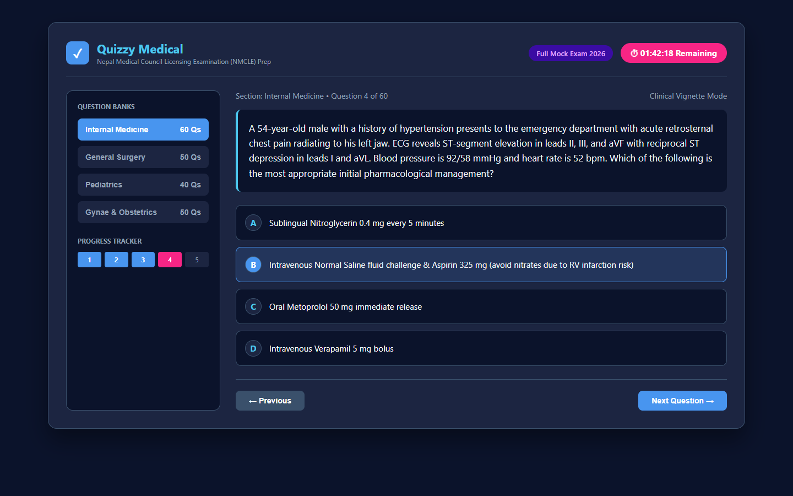
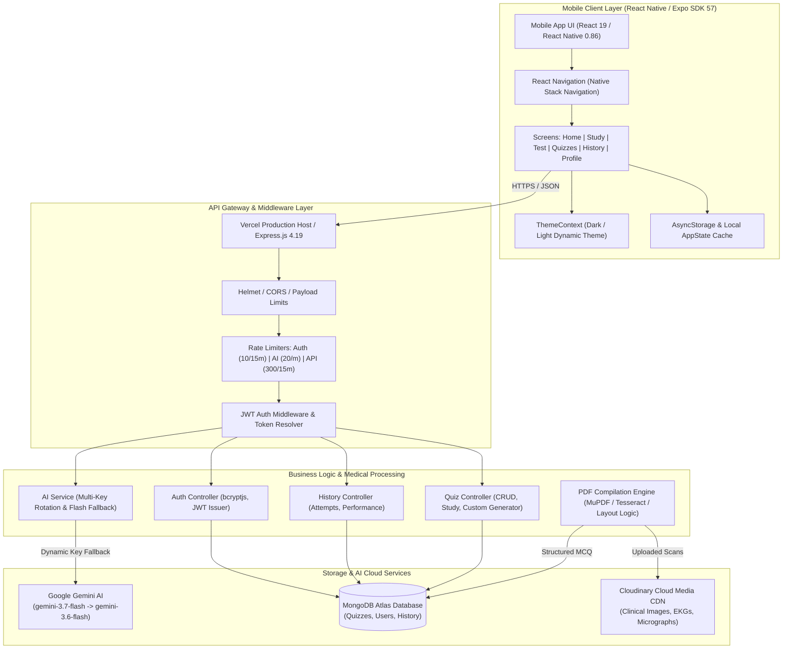
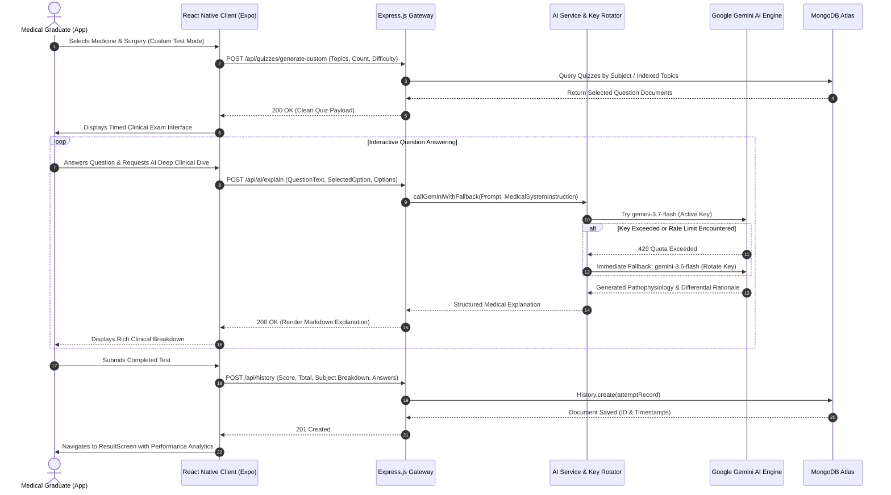
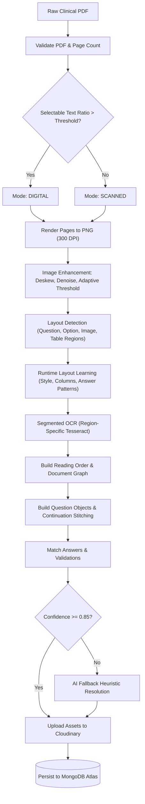

# 🩺 DCP-QUIZZY — Medical Licensing Examination (NMCLE) Mobile Platform

<div align="center">


### High-Yield Medical Council Licensing Exam Preparation Engine
*Empowering MBBS Graduates in Nepal with Algorithmic Question Ingestion, Adaptive Study Simulations, and Real-Time AI Clinical Tutoring*

[](https://github.com)
[](https://reactnative.dev)
[](https://expo.dev)
[](https://nodejs.org)
[](https://expressjs.com)
[](https://mongodb.com)
[](https://ai.google.dev)
[](https://dcp-quizzy-62ya-murex.vercel.app/api)
[](LICENSE)

</div>

---

## Application Screenshot & Interface Preview

<div align="center">
  
</div>

---

## 🌐 Suite 5 Ecosystem & Cross-Repository Links

**DCP-QUIZZY** is the mobile flagship of the **Suite 5 (Medical & AI Quiz Ecosystem)**. It coordinates seamlessly with companion cloud platforms and AI authoring suites across the ecosystem:

| Repository | Role | Core Technology | Link |
| :--- | :--- | :--- | :--- |
| **DCP-QUIZZY** (This Repo) | Medical Mobile App Client & Licensing Engine | React Native / Expo 57 / Express / MongoDB | [DCP-QUIZZY](file:///c:/Users/pandi/OneDrive/Desktop/github/DCP-QUIZZY) |
| **quiz-Generator--main** | Enterprise AI MCQ Backend & Full-Stack Suite | Node.js Express 5 / Gemini AI / React 19 MUI | [quiz-Generator--main](file:///c:/Users/pandi/OneDrive/Desktop/github/quiz-Generator--main) |
| **mcq-main-frontend** | Production Web Exam Center & Analytics Portal | React 19 / Vite / Recharts / Vercel Host | [mcq-main-frontend](file:///c:/Users/pandi/OneDrive/Desktop/github/mcq-main-frontend) |
| **quiz-Generator-** | Foundational AI MCQ Algorithmic Core Prototype | Express / Google Generative AI / Vite Prototype | [quiz-Generator-](file:///c:/Users/pandi/OneDrive/Desktop/github/quiz-Generator-) |

---

## 📌 Executive Summary & Medical Impact

The **Nepal Medical Council Licensing Examination (NMCLE)** is the high-stakes qualifying barrier for medical graduates entering clinical practice across Nepal. Traditional preparation relies heavily on static question banks, fragmented PDFs, and rote memorization with minimal rationale verification.

**DCP-QUIZZY** bridges this critical clinical gap by providing:
- **Verified High-Yield Clinical Corpora**: Dedicated digital banks spanning **Internal Medicine**, **General Surgery**, **Pediatrics**, and **Gynecology & Obstetrics (Gynae & Obs)**, comprising thousands of past council and curriculum questions.
- **Compiler-Grade PDF Ingestion Pipeline**: An OCR and layout-learning parser (`algorithm.txt`) transforming complex paper MCQs, continuation tables, and clinical radiographs into structured JSON documents.
- **Adaptive Dual Modes**: Instant pedagogical reinforcement in **Study Mode** with markdown explanations alongside strict **Exam Simulation Mode** featuring timing constraints, review flags, and negative-marking audits.
- **Resilient AI Clinical Tutoring**: Integration with Google Gemini (`gemini-3.7-flash` and `gemini-3.6-flash`) with dynamic multi-key rotation (up to 20 keys) to provide conversational bedside teaching, pathophysiological breakdowns, and differential diagnoses on demand.

<div align="center">
  
</div>

---

## 🚀 Key Features

- 🏥 **Specialty Medical Subject Banks**: Comprehensive question repositories for:
  - **Internal Medicine** (`medicine.json` — 1.03 MB): Cardiology, Pulmonology, Neurology, Nephrology, Gastroenterology.
  - **General Surgery** (`surgery.json` — 951 KB): Operative surgery, Orthopedics, Trauma management, Urology, ENT, Ophthalmology.
  - **Pediatrics** (`pediatrics.json` — 670 KB): Neonatology, developmental milestones, pediatric infectious emergencies.
  - **Gynecology & Obstetrics** (`Gynae & OBS.json` — 775 KB): Maternal-fetal medicine, high-risk labor, reproductive pathology.
- 📑 **Algorithmic Document Pipeline**: Complete multi-stage PDF compiler pipeline:
  - Image deskewing, binarization, denoising, and 300 DPI PNG extraction.
  - Runtime layout heuristics for questions, sub-options, explanation blocks, and multi-page continuation stitching.
  - Cloudinary cloud synchronization for medical imaging, EKGs, and histopathology micrographs.
- ⚡ **Dual Educational Modalities**:
  - **Study Mode**: Real-time feedback, detailed clinical rationale, and one-tap AI Clinical Mentor dialogue.
  - **Test Mode**: Timed exam emulation matching NMCLE timing protocols, flag-for-review navigation drawer, and performance analytics.
- 🤖 **Zero-Downtime Multi-Key Gemini Rotation**:
  - Load-balanced round-robin key pool (`GEMINI_API_KEY_1` through `GEMINI_API_KEY_20`).
  - Automatic model fallback from `gemini-3.7-flash` to `gemini-3.6-flash` upon transient quota exhaustion.
- 🔒 **Enterprise-Grade Security & Performance**:
  - Multi-tier IP rate limiting (Auth: 10 req/15 min; AI: 20 req/min; General: 300 req/15 min).
  - Helmet HTTP security headers, Brotli/Gzip payload compression, and JWT authentication.
  - Indexed MongoDB schemas optimized for sub-millisecond topic extraction and user history audits.
- 📱 **Cross-Platform Mobile Excellence**:
  - Developed with React Native 0.86 and Expo SDK 57.
  - Pinch-to-zoom clinical image viewer (`react-native-image-viewing`).
  - Native offline state caching (`@react-native-async-storage/async-storage`) and dark/light dynamic theme engine.

---

## 🏛️ System Architecture

The following diagram illustrates the complete DCP-QUIZZY end-to-end medical ecosystem:



---

## 🔄 Data Flow & Sequence Diagram

This sequence depicts a student initiating a custom NMCLE quiz session, resolving an ambiguous clinical case with the interactive AI tutor, and persisting their score history:



---

## 🛠️ Complete Tech Stack Breakdown

| Layer | Technology | Version | Purpose / Architectural Responsibility |
| :--- | :--- | :--- | :--- |
| **Mobile Runtime** | React Native | `0.86.3` | Native cross-platform rendering engine for iOS and Android |
| **Mobile Framework** | Expo SDK | `~57.0.21` | Modern managed workflow, native build tooling, and device APIs |
| **UI Componentry** | React Native Paper / Custom | `19.2.3` | Fluid responsive mobile design, dark/light theming, modal interfaces |
| **Navigation** | React Navigation | `^6.1.18` | Native Stack navigator, transition screens, and modal presentations |
| **Icons & Visuals** | Lucide React Native | `^0.372.0` | Accessible iconography for clinical domains, timers, and metrics |
| **Media & Zoom** | react-native-image-viewing | `^0.2.2` | High-fidelity pinch-and-zoom modal for clinical X-rays and diagrams |
| **State & Storage** | AsyncStorage & Context API | `2.2.0` | Persistent token storage, theme persistence, offline answer cache |
| **HTTP Client** | Axios | `^1.6.8` | Interceptor-managed network requests with automatic bearer injection |
| **Backend Framework** | Node.js / Express.js | `4.19.2` | High-throughput REST API gateway with robust routing and error filters |
| **Database & ODM** | MongoDB / Mongoose | `^8.3.1` | Document persistence, compound indexing, and pre-save validation hooks |
| **Generative AI** | `@google/genai` & Generative SDK | `^2.13.0` | Gemini 3.7 & 3.6 Flash reasoning for explanations and interactive chat |
| **OCR & Parsing** | MuPDF / pdf-lib / Tesseract.js | `^1.28.0` / `^7.0.0` | Algorithmic conversion of scanned medical papers into structured MCQs |
| **Media Hosting** | Cloudinary SDK | `^1.41.3` | Cloud-hosted storage and CDN distribution for medical diagrams |
| **Security & Auditing**| Helmet, Compression, Rate-Limit| `8.3` / `8.6` | HTTP header protection, Brotli compression, IP throttling, bcryptjs |

---

## 📂 Repository Directory Structure

```text
DCP-QUIZZY/
├── .gitignore                      # Git exclusion rules for node_modules, .expo, .env
├── algorithm.txt                   # Compiler specification for PDF-to-MCQ OCR pipeline
├── Gynae & OBS.json               # 775 KB curated clinical question bank for Ob/Gyn
├── logo2.png                       # High-resolution secondary emblem
├── medicine.json                   # 1.03 MB curated question bank for Internal Medicine
├── package.json                    # Workspace metadata
├── pediatrics.json                 # 670 KB curated question bank for Pediatrics
├── quizzy.png                      # Primary application banner & logo
├── surgery.json                    # 951 KB curated question bank for Surgery & Subspecialties
├── vercel.json                     # Serverless deployment configuration for Vercel
│
├── backend/                        # Node.js Express REST API server
│   ├── config/
│   │   ├── cloudinary.js           # Cloudinary SDK media integration
│   │   └── db.js                   # MongoDB connection lifecycle with retry logic
│   ├── controllers/
│   │   ├── aiController.js         # Endpoints for question explanations and tutor chat
│   │   ├── authController.js       # Register, login, and password management
│   │   ├── historyController.js    # Attempt storage, analytics, and deletion
│   │   └── quizController.js       # CRUD, subject extraction, custom quiz generation
│   ├── middleware/
│   │   └── authMiddleware.js       # JWT header inspection and user validation
│   ├── models/
│   │   ├── History.js              # Test attempt history schema with question breakdown
│   │   ├── Quiz.js                 # Subject/topic indexed schema with pre-save hooks
│   │   └── User.js                 # Authentication, role, and credential schema
│   ├── routes/
│   │   ├── aiRoutes.js             # /api/ai routes (explain, chat)
│   │   ├── authRoutes.js           # /api/auth routes (register, login, change-password)
│   │   ├── historyRoutes.js        # /api/history routes
│   │   └── quizRoutes.js           # /api/quizzes routes (study, custom, topic)
│   ├── services/
│   │   └── aiService.js            # Multi-key rotation pool & Gemini 3.7/3.6 fallback
│   ├── utils/
│   │   └── jwt.js                  # Token generation, signing, and verification
│   ├── .env.example                # Sanitized template for environment variables
│   ├── ecosystem.config.js         # PM2 production cluster process definition
│   ├── package.json                # Express server dependencies
│   ├── seedMedicine.js             # Ingestion utility for Internal Medicine JSON
│   ├── seedNMCLE.js                # Bulk database seeder for complete NMCLE syllabus
│   ├── seedQuizzes.js              # Core quiz and subject seeder
│   └── server.js                   # Main application entry point & rate-limiter setup
│
└── frontend/                       # React Native / Expo Mobile Application
    ├── assets/                     # App icons, splash screens, and login backgrounds
    ├── src/
    │   ├── components/             # Reusable modular UI components
    │   │   ├── AiChatModal.js      # Modal interface for interactive Gemini medical tutor
    │   │   ├── BottomTabBar.js     # Custom persistent bottom navigation bar
    │   │   ├── CustomQuizBuilderModal.js # Interactive modal for custom quiz creation
    │   │   ├── ManageQuizModal.js  # Administrative quiz editor modal
    │   │   ├── MarkdownRenderer.js # Formatted medical rationale & table renderer
    │   │   ├── PageLoadingAnimation.js # Native loading transitions
    │   │   ├── TestConfigModal.js  # Timing and question count configuration
    │   │   ├── UploadModal.js      # Scanned document & question upload handler
    │   │   └── ZoomableImageCard.js# Pinch-and-zoom clinical image viewer
    │   ├── context/
    │   │   └── ThemeContext.js     # Light/Dark mode state and styling context
    │   ├── screens/                # Mobile application screens
    │   │   ├── HistoryScreen.js    # Historical performance trends and logs
    │   │   ├── HomeScreen.js       # Dashboard with recent tests and subject quick-links
    │   │   ├── LoginScreen.js      # User credentials and session sign-in
    │   │   ├── MainScreen.js       # Container wrapper for tab navigation
    │   │   ├── ProfileScreen.js    # Account details and study statistics
    │   │   ├── QuizzesScreen.js    # Subject and topic quiz directory
    │   │   ├── ResultScreen.js     # Deep score review with correct answer rationales
    │   │   ├── StudyScreen.js      # Immediate-feedback question study workstation
    │   │   └── TestScreen.js       # Strict timed exam simulation environment
    │   └── services/
    │       ├── api.js              # Dynamic Axios client (LAN auto-detect + Vercel prod)
    │       ├── appStateCache.js    # Local in-memory cache for ultra-fast navigation
    │       └── storage.js          # Encapsulated AsyncStorage utility functions
    ├── App.js                      # Root Expo application entry point
    ├── app.json                    # Expo application manifest & configuration
    ├── babel.config.js             # Babel compiler preset configuration
    ├── eas.json                    # Expo Application Services cloud build profile
    └── package.json                # Mobile application dependencies
```

---

## ⚡ Local Setup & Installation

### 1. Prerequisites
- **Node.js**: v20.x or higher installed (`node -v`)
- **npm** or **yarn**: npm v9+ recommended
- **Expo CLI**: `npm install -g expo-cli`
- **Expo Go App**: Installed on physical Android / iOS device (or Android Studio emulator / Xcode simulator)
- **MongoDB**: Active MongoDB Atlas cluster or local MongoDB instance running on port `27017`
- **Google Gemini API Key**: Obtainable from [Google AI Studio](https://aistudio.google.com/)

---

### 2. Repository Cloning & Environment Setup

```bash
# Clone the repository
git clone https://github.com/your-username/DCP-QUIZZY.git
cd DCP-QUIZZY
```

#### A. Configure the Backend Server
```bash
cd backend
cp .env.example .env
```

Edit `backend/.env` with your credentials:
```env
PORT=5000
MONGO_URI=mongodb+srv://<username>:<password>@cluster0.mongodb.net/dcp_quizzy?retryWrites=true&w=majority
JWT_SECRET=your_super_secret_jwt_key_at_least_32_characters
GEMINI_API_KEY=your_primary_gemini_api_key

# Optional: Add extra keys to activate automatic load-balancing and quota-resilience
GEMINI_API_KEY_1=your_secondary_gemini_key
GEMINI_API_KEY_2=your_tertiary_gemini_key

# Cloudinary (Optional, for clinical scan uploads)
CLOUDINARY_CLOUD_NAME=your_cloud_name
CLOUDINARY_API_KEY=your_api_key
CLOUDINARY_API_SECRET=your_api_secret
```

Install backend dependencies and seed the database:
```bash
npm install

# Seed the question banks (Internal Medicine, Surgery, Pediatrics, Gynae & Obs)
npm run seed:nmcle
# Or run specific subject seeders:
# npm run seed
```

Start the backend development server:
```bash
npm run dev
# Server running on port 5000 (0.0.0.0 - LAN accessible)
```

---

#### B. Configure the Frontend Mobile App
Open a new terminal window:
```bash
cd ../frontend
cp .env.example .env
```

Install mobile dependencies:
```bash
npm install
```

Start the Expo development server:
```bash
npm start
```
- Press `a` to run on a connected Android device or emulator.
- Press `i` to run on an iOS simulator.
- Scan the printed QR code using the **Expo Go** app on your physical smartphone.

> [!TIP]
> The mobile client automatically resolves your local development workstation's LAN IP address over Expo Go. If running on physical hardware, ensure both computer and mobile device share the same Wi-Fi subnet.

---

## 📡 API Reference Table

The Express.js backend exposes structured REST endpoints mounted under `/api`.

| Method | Endpoint | Description | Auth Required | Rate Limit |
| :--- | :--- | :--- | :---: | :--- |
| `GET` | `/` | API status, health info, and root endpoint catalog | No | 300 / 15m |
| `GET` | `/health` | System health check and server timestamp | No | 300 / 15m |
| `POST`| `/api/auth/register` | Register new medical student account | No | 10 / 15m |
| `POST`| `/api/auth/login` | Authenticate user and return JWT bearer token | No | 10 / 15m |
| `POST`| `/api/auth/change-password` | Update existing user password | **Yes (Bearer)** | 10 / 15m |
| `GET` | `/api/quizzes` | Fetch list of all available subject quizzes | No | 300 / 15m |
| `GET` | `/api/quizzes/study-structure` | Retrieve hierarchical subject and topic taxonomy | No | 300 / 15m |
| `GET` | `/api/quizzes/sources` | Fetch all distinct sources and syllabus units | No | 300 / 15m |
| `GET` | `/api/quizzes/topic/:topicName`| Extract questions filtered by specific clinical topic | No | 300 / 15m |
| `POST`| `/api/quizzes/generate-custom` | Dynamically compile custom multi-subject quiz | **Yes (Bearer)** | 300 / 15m |
| `GET` | `/api/quizzes/:id` | Fetch full question set for specified quiz ID | No | 300 / 15m |
| `POST`| `/api/quizzes` | Create a new custom or administrative quiz | **Yes (Bearer)** | 300 / 15m |
| `PUT` | `/api/quizzes/:id` | Update quiz metadata or properties | **Yes (Bearer)** | 300 / 15m |
| `DELETE`| `/api/quizzes/:id` | Remove a quiz record | **Yes (Bearer)** | 300 / 15m |
| `POST`| `/api/quizzes/:id/questions` | Append an individual question to a quiz | **Yes (Bearer)** | 300 / 15m |
| `PUT` | `/api/quizzes/:id/questions/:qId`| Update a specific question within a quiz | **Yes (Bearer)** | 300 / 15m |
| `DELETE`| `/api/quizzes/:id/questions/:qId`| Delete a specific question from a quiz | **Yes (Bearer)** | 300 / 15m |
| `POST`| `/api/history` | Save a completed test attempt with full score breakdown| **Yes (Bearer)** | 300 / 15m |
| `GET` | `/api/history` | Retrieve student's chronological test attempt history | **Yes (Bearer)** | 300 / 15m |
| `GET` | `/api/history/:id` | Retrieve comprehensive audit for a specific attempt | **Yes (Bearer)** | 300 / 15m |
| `DELETE`| `/api/history/:id` | Delete a specific historical test attempt | **Yes (Bearer)** | 300 / 15m |
| `POST`| `/api/ai/explain` | Generate clinical rationale for question via Gemini | No | 20 / 1m |
| `POST`| `/api/ai/chat` | Interactive multi-turn clinical tutor conversation | No | 20 / 1m |

---

## 🔬 PDF-to-MCQ Algorithmic Pipeline (`algorithm.txt`)

A signature capability of DCP-QUIZZY is its standalone compilation pipeline for converting printed medical books, past NMCLE exam papers, and question compilations into database-ready documents:



---

## 🚢 Production Deployment

### Backend Serverless (Vercel)
The backend is configured with `vercel.json` for zero-configuration deployment to Vercel Serverless Functions:
1. Link your repository in the Vercel Dashboard.
2. Configure Environment Variables in the Project Settings:
   - `MONGO_URI`
   - `JWT_SECRET`
   - `GEMINI_API_KEY` (and optional secondary keys)
   - `CLOUDINARY_CLOUD_NAME`, `CLOUDINARY_API_KEY`, `CLOUDINARY_API_SECRET`
3. Vercel automatically deploys requests routing all traffic to `backend/server.js`.

### Standalone Node.js / Linux VPS (PM2)
For dedicated deployment on Ubuntu or Docker:
```bash
cd backend
npm install --production
pm2 start ecosystem.config.js --env production
pm2 save
```

### Mobile Production Builds (Expo EAS Build)
1. Configure `eas.json` for cloud builds:
   ```bash
   npm install -g eas-cli
   eas login
   eas build:configure
   ```
2. Build Android APK / App Bundle:
   ```bash
   eas build --platform android --profile production
   ```
3. Build iOS IPA:
   ```bash
   eas build --platform ios --profile production
   ```

---

## 🛡️ Security, Performance & Best Practices

- **Zero Hardcoded Secrets**: All private credentials, database URIs, and API tokens are dynamically resolved from environment variables. `.env` patterns are strictly ignored by `.gitignore`.
- **Defensive Multi-Key AI Architecture**: Prevents single-point rate limiting failures by automatically rotating across up to 20 Gemini API keys and falling back from `gemini-3.7-flash` to `gemini-3.6-flash`.
- **Layered Rate Limiting**: Dedicated rate-limit windows protect CPU-intensive AI generation and prevent brute-force authentication attacks on `/api/auth/login`.
- **Database Indexing**: Compound MongoDB indexes on `{ isCustom: 1, createdAt: -1 }` and `{ userId: 1, createdAt: -1 }` ensure instant retrieval across large collections.
- **Client Cache Isolation**: React Native `appStateCache.js` caches active quiz sessions in memory, eliminating redundant network hops during rapid question navigation.
- **Image CDN Optimization**: Clinical diagrams are uploaded to Cloudinary, ensuring automatic WebP transcoding and low latency on mobile cellular connections.

---

## 📄 License

This project is licensed under the **MIT License** — see the [LICENSE](LICENSE) file for full details.

---

<div align="center">
  <sub>Part of the <b>Suite 5 Medical & AI Quiz Ecosystem</b>. Built with ❤️ for medical professionals and graduates preparing for clinical licensing examinations.</sub>
</div>
